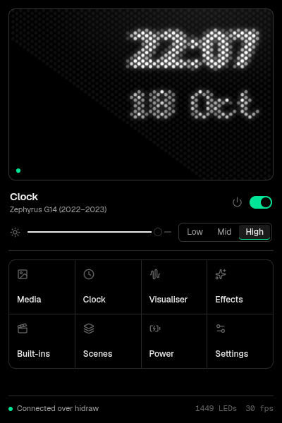
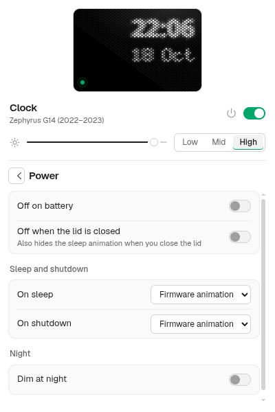

# animatrix

Control the **ASUS ROG AniMe Matrix** lid display on Linux: images, GIFs, video, text, clocks, a music visualiser, generative effects and the firmware's own animations. It comes in four parts:

- **`animatrixd`**: a small daemon, the only process that writes to the device. It runs as a systemd user service and exposes a D-Bus API.
- **A tray app**: a compact 400×600 panel with a live preview of the real LED lattice.
- **`animatrix`**: a command-line tool.
- **`@anshmehta7x/animatrix`**: a TypeScript library for your own scripts.

| Model                                          | Status                                                                                                                                                                   |
| ---------------------------------------------- | ------------------------------------------------------------------------------------------------------------------------------------------------------------------------ |
| Zephyrus G14 2022/2023 (GA402R/X/N)            | **Tested on a GA402XU** for the transport, frame timing, daemon, CLI and tray. orientation and brightness confirmed by eye; see [hardware notes](docs/hardware-notes.md) |
| Zephyrus G14 2020/21 (GA401), G16 2023 (GU604) | Profiles from research, **untested**                                                                                                                                     |
| Slash Lighting laptops (GA403, GU605, …)       | Refused: same USB ID, different hardware                                                                                                                                 |

## Install

You need Node.js ≥ 22, pnpm (`corepack enable`) and ffmpeg (for video). PipeWire's `pw-record` or PulseAudio's `parec` is needed for the visualiser.

```sh
git clone git@github.com:anshmehta7x/animatrix.git && cd animatrix
make install            # builds and installs to ~/.local (no root)
sudo make install-udev  # once: lets your user open the device
make enable             # start animatrixd now and at every login
animatrix-tray          # open the panel
```

### Device access (udev)

The AniMe Matrix (`0b05:193b`) is root-only by default. [`packaging/udev/70-animatrix.rules`](packaging/udev/70-animatrix.rules) gives the logged-in user access through `uaccess`. If you see _Permission denied_, install it:

```sh
sudo cp packaging/udev/70-animatrix.rules /etc/udev/rules.d/
sudo udevadm control --reload && sudo udevadm trigger
```

### The tray icon on GNOME

Stock GNOME has no tray. Install the AppIndicator extension, log out and back in (required on Wayland), then enable it:

```sh
sudo dnf install gnome-shell-extension-appindicator        # Fedora
sudo apt install gnome-shell-extension-appindicator        # Debian/Ubuntu
gnome-extensions enable appindicatorsupport@rgcjonas.gmail.com
```

Everything also works **without a tray**. Open the panel from the app grid ("animatrix"). Launching it again toggles it, so a keyboard shortcut bound to `animatrix-tray` works as a toggle. The panel shows a one-time hint when no tray host is found.

On Wayland the compositor decides where windows open, so GNOME centres the panel; on X11 it opens next to the tray icon.

### asusd

If `asusd` (asusctl) is running it claims the AniMe device, and animatrix tells you so rather than fighting it. Stop it with `sudo systemctl stop asusd` to use animatrix.

## Screenshots

<p>
  
  
</p>

## Command line

```sh
animatrix status
animatrix brightness medium            # hardware level: off | low | medium | high | 0-3
animatrix image cat.png --fit cover --dither floyd-steinberg
animatrix gif loop.gif --speed 1.5
animatrix video clip.mp4 --fps 24
animatrix text "hello" --speed 20
animatrix clock --face analogue
animatrix play visualiser style=spectrum
animatrix builtins --awake rogLogoGlitch --sleep starfield
animatrix scene apply "Matrix rain"
animatrix effects                      # every effect and its parameters
animatrix --direct test-pattern        # bypass the daemon
```

## Library

```ts
import { Matrix } from "@anshmehta7x/animatrix";

const m = await Matrix.open(); // via the daemon if running, else direct
await m.setBrightness("medium");
await m.showImage("cat.png", { fit: "contain" });
await m.playGif("loop.gif");
await m.draw((c) => {
  c.clear();
  c.text(0, 10, "hi");
  c.pixel(5, 5, 255);
});
await m.setBuiltins({ awake: "rogLogoGlitch", sleep: "starfield" });
await m.close();
```

Through the daemon, effects keep running after your script exits. In direct mode (`Matrix.open({ direct: true })`, or when no daemon runs) animations live in your process; `await m.wait()` keeps it alive until a non-looping animation ends. Errors are typed: `DeviceNotFoundError`, `PermissionDeniedError` (its `hint` explains the udev rule), `DeviceBusyError` (`holder` is `"asusd"` or `"animatrixd"`), `UnsupportedModelError`, and so on. They all extend `AnimatrixError`, which has a `code`.

- More examples are in [`examples/`](examples): hello pixel, image, GIF, clock, a custom effect, and [Python over D-Bus](examples/python/dbus_example.py).
- API reference: `pnpm docs:api` generates TypeDoc into `docs/api/`.
- The daemon's D-Bus API is documented in [docs/dbus-api.md](docs/dbus-api.md).

## Configuration

`~/.config/animatrix/config.toml` holds brightness, power policy (off on battery or with the lid closed, what to do on sleep and shutdown), scenes, the playlist, night dimming and notification flash. The tray and `animatrix config set section.key=value` edit it for you.

## Docs

- [Architecture](docs/architecture.md)
- [Protocol summary](docs/protocol.md)
- [Hardware notes / Phase 0 findings](docs/hardware-notes.md)
- [D-Bus API](docs/dbus-api.md)
- [Packaging for distros](docs/packaging.md)
- [Contributing: add an effect or a model](CONTRIBUTING.md)

## Licence

MIT. Protocol facts come from public research on G-Helper, asusctl and Starlight; no code was copied. See [NOTICE](NOTICE). Not affiliated with ASUS.
